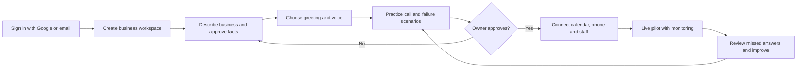
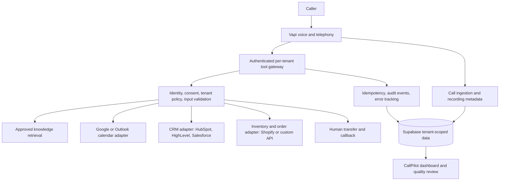
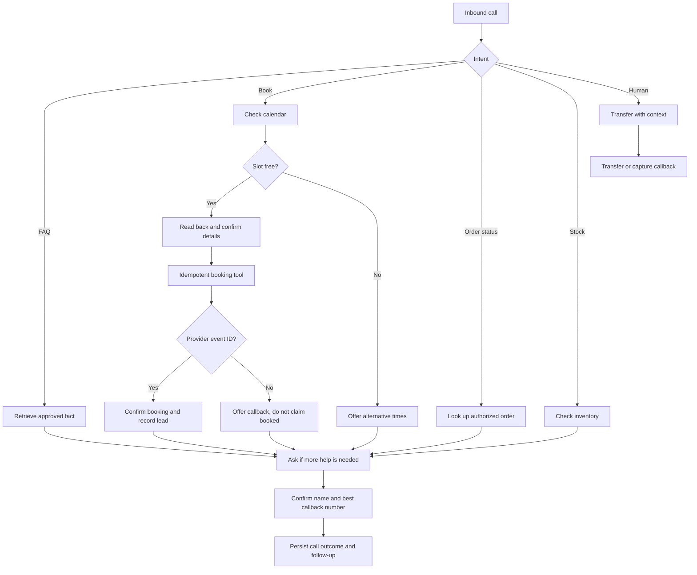

# CallPilot — customer-first AI front desk product blueprint
**Date:** 2026-11-07 · **Status:** working plan, not a claim of full production readiness

## Product decision
Build an **original CallPilot product** with feature-level parity to leading AI receptionists. Do not duplicate competitors' website copy, visual trade dress, code, illustrations, logos, or proprietary prompts. Compete on faster onboarding, reliable outcomes, transparent pricing, human handoff, and verified business knowledge.

## Competitor benchmark (publicly documented, not independently tested)
| Product | Published US starting price | Differentiating features worth matching |
| --- | --- | --- |
| Goodcall GC4 | $79/mo Starter; $129 Growth; $299 Scale, metered by unique callers | Gabi natural-language builder, practice tests before approval, configurable workers, booking, CRM, ecommerce/inventory lookups, human transfer, change rollback. Current FAQ/pricing differ from older indexed GC3 pages. |
| Smith.ai AI Receptionist | Free 25 calls/mo ($3/call afterward); Pro from $150/mo for 75 calls | Quality Studio, lead qualification, call routing, calendar booking, human escalation, call summaries. |
| RingCentral AI Receptionist (US) | Standalone from $49/mo with 100 minutes, $0.50/min overage; add-on from $39/mo | Website auto-setup, multilingual call handling, scheduling, lead capture, Salesforce/HubSpot/Zoho, transcripts, transfers, SMS. |
| CallPilot current advertised plans | Starter $49/100 min; Growth $99/300 min; Business $179/600 min; $25 setup | Multi-tenant workspace, approved knowledge and semantic retrieval, Vapi calling, call insights, Google Calendar OAuth/test bookings; **not** voice-booking parity yet. |

**Primary sources:** https://www.goodcall.com/ ; https://www.goodcall.com/pricing ; https://www.goodcall.com/faq ; https://smith.ai/pricing/ai-receptionist ; https://www.ringcentral.com/pricing/ai-receptionist.html . Prices can change and must be reverified before pricing decisions. Goodcall's older GC3 pricing pages and current GC4 FAQ can conflict; prioritize the current product pages.

## Customer journey

## Runtime architecture

## Feature status and release gates
| Feature | Current status | Definition of done |
| --- | --- | --- |
| Customer account and tenant isolation | Implemented; needs adversarial auth testing | Cross-tenant requests denied; session expiry safe |
| Google sign-in | Frontend entry added; **Google provider setup and live OAuth not verified** | New user completes OAuth and creates workspace in 2 minutes |
| Guided setup | Launch Studio first version committed | Nontechnical user approves business knowledge, saves greeting, tests answer, sees honest integration status |
| Website ingestion | Not built | URL fetch with SSRF/DNS rebinding protection, copyright-safe extraction, human approval and source tracking |
| Knowledge answer test | Implemented text-only | 20 positive/negative questions pass, no hallucinated prices |
| Live browser practice call | Not built | Browser voice test with costs and abuse controls; practice changes never auto-publish |
| Reliable inbound calls | Partial Vapi routing and ingestion | 20 consecutive calls captured, zero missing leads, accurate status |
| Bilingual English/Spanish | Not validated; known test failures | Mid-call language switch, accents, multilingual retrieval, no repeated loops |
| Contact capture | Prompt configured, not end-to-end verified | Caller name, number confirmation, reason and follow-up appear in lead record |
| Calendar availability | Implemented and OAuth connected for one workspace | Timezone, DST, conflict, auth expiry, duplicate and cancellation tests pass |
| Voice booking | **Not built** | Tool checks free/busy, books once, confirms event ID, sends confirmation, handles failure safely |
| Orders and inventory | Not built | Read-only stock/order lookup; transactional order creation only with explicit confirmation and idempotency |
| CRM and Gmail | Not built for tenant self-service | OAuth, least-privilege scopes, field mapping, revocation, audit, consent |
| Human handoff | Not validated | Transfer with context; fallback on failure |
| Billing | Stripe test mode, not customer billing | Test and webhook replay, refunds, entitlements, hard quota guard, clear disclosures |
| Monitoring and support | Partial call intelligence | Alerts for missed webhook, tool error, booking conflict, silence, failed transfer, latency |

## Technical rules
1. **One tenant, one policy boundary:** provider IDs, tools, records and credentials must be scoped to a verified organization, never a model-supplied tenant ID.
2. **Tools are typed, narrow and permissioned:** separate `lookup_inventory`, `get_order_status`, `check_availability`, `book_appointment`, `create_lead`, `transfer_call`; never give the LLM unrestricted network or database access.
3. **Writes require explicit caller confirmation:** say back service, time, contact, quantity and total; confirm before booking, placing an order or updating a CRM record. Use idempotency keys and a provider confirmation ID.
4. **Graceful failure:** if API is down or the answer is uncertain, take a message or transfer to a human; never invent stock, appointment confirmations, or pricing.
5. **Privacy by default:** disclose AI, obtain legally required recording consent, limit retention, encrypt OAuth tokens, protect call recordings and prevent cross-tenant access.
6. **Separate build, test and publish:** version each agent configuration and allow rollback; no unreviewed changes to a live assistant.
7. **Cost visibility:** log voice seconds, LLM/STT/TTS charges, tool calls, phone/SMS charges, and free test spend per tenant; enforce budgets before selling unlimited minutes.
8. **Quality gate:** monitor answer accuracy, successful action completion, contact capture, handoff success, latency, failed calls and customer-reported corrections.

## Acceptance test flows

**Minimum end-to-end test matrix:** new caller; repeat caller; unknown caller ID; Spanish-only caller; English-Spanish switch; quiet caller; interruptions; 4-minute timeout; published price; unapproved price; ambiguous FAQ; wrong stock; out-of-stock; order not found; calendar busy; calendar free; simultaneous double booking; expired Google token; failed CRM write; failed transfer; missing recording consent; missed Vapi webhook; duplicate webhook; payment/subscription not active; malicious prompt injection.

## Implementation order (not all complete)
- **P0 (first):** launch wizard + Google login configuration; stable caller contact extraction; test call QA; multilingual retrieval; publish-only-after-test. Fix these before paid onboarding.
- **P1:** voice calendar tool and idempotency, booking confirmations, calendar alternatives, human transfer, SMS/email follow-up.
- **P2:** connector framework with OAuth and approved scopes; first vertical adapters (Shopify stock/order status, HubSpot/HighLevel contacts, Gmail notifications); tenant-specific workflow builder.
- **P3:** browser voice preview, AI-assisted agent edits with approval/version history, per-tenant quality scorecards, A/B prompts, multi-location routing, polished self-service support.

## Unit economics gate
The listed competitor retail prices are **not** CallPilot's underlying API costs. Do not assume Goodcall's unlimited minutes are profitable for CallPilot. Before launch, collect actual Vapi invoices and subprovider rates (voice model, STT, TTS, telephony), Render/Supabase/Stripe/SMS expenses, test-call costs and call-duration distributions. Model 100/300/600-minute cohorts, heavy callers, concurrency and abuse, and reserve a gross-margin buffer. Never switch live Stripe charges or buy phone numbers without explicit cost review.

## Immediate next action
Run Launch Studio at `/app#studio`, finish Google provider setup, and test one real inbound call end-to-end with name/number capture. Build voice booking behind a test gate; do not tell customers it is live until a calendar event and confirmation can be independently verified.
